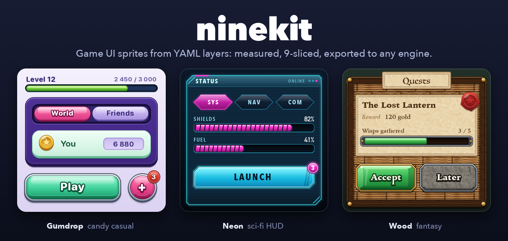
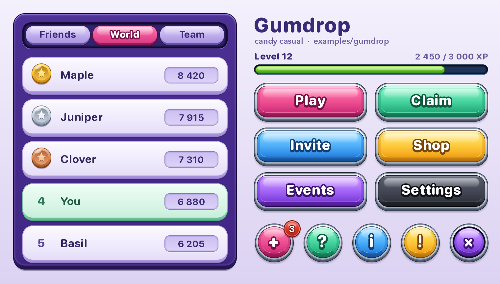
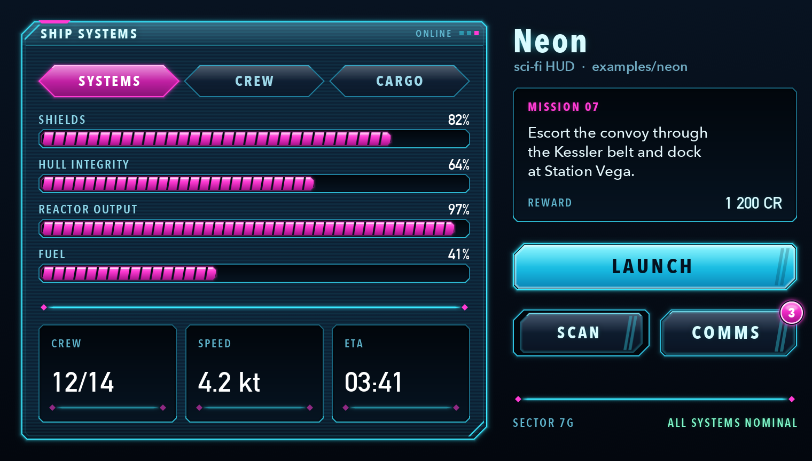
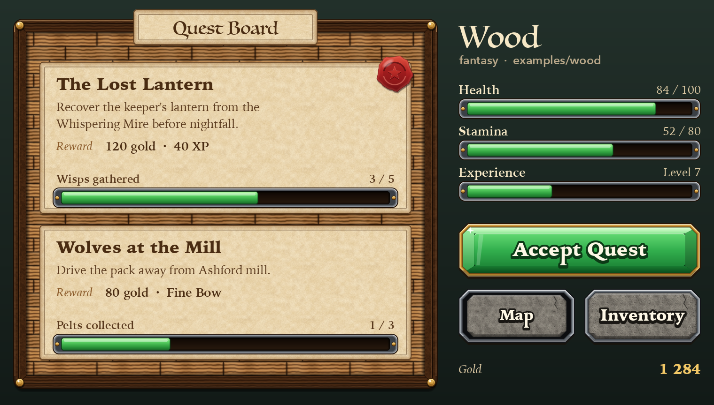
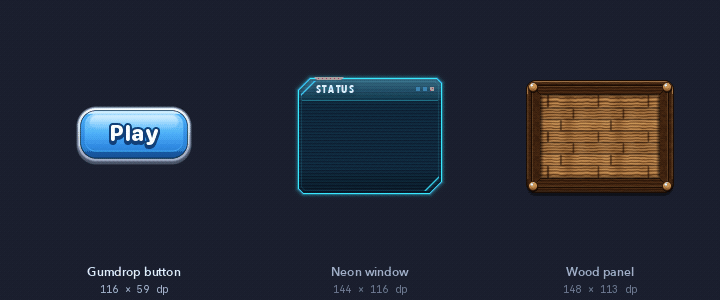
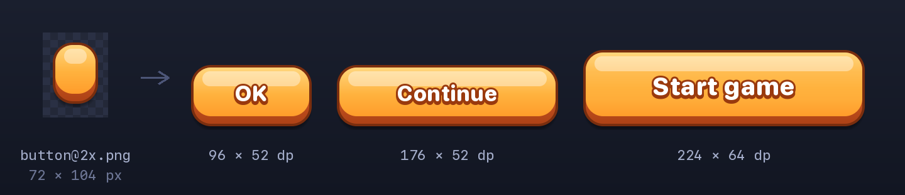
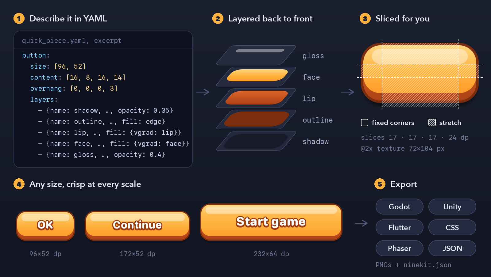
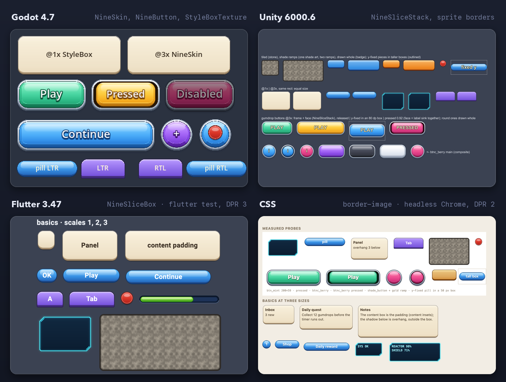
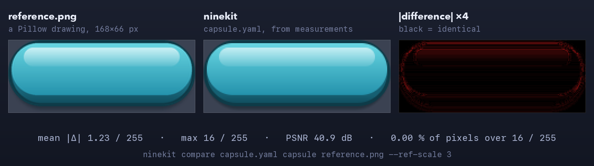

<p align="center">
  
</p>

<p align="center">
  <b>Game and app UI sprites from YAML layers: measured, 9-sliced, verified, exported to any engine.</b>
</p>

<p align="center">
  <a href="LICENSE"></a>
  <a href="pyproject.toml"></a>
  <a href="skills/ninekit/references/engines.md"></a>
  <a href="#use-it-with-ai-agents"></a>
</p>

## What is ninekit?

ninekit draws UI pieces (panels, buttons, tabs, pills, progress bars, badges, frames, HUD plates) from a YAML
spec in which each piece is a stack of vector layers. `ninekit build` renders every piece natively at every scale
(@1x, @2x, @3x, ...) and writes one engine-neutral manifest with the 9-slice borders, stretch modes, label insets
and overhangs. `ninekit export` turns that into ready-to-use assets for **Godot, Unity, Flutter, CSS, Phaser** or
plain JSON. Nothing is painted by hand and nothing ships unmeasured: `verify` proves each piece stretches cleanly,
and the whole workflow is packaged as an agent skill, so a coding agent can do it for you.

## Gallery

Three sample concepts. Every panel, button, bar, tab and badge below is a sprite rendered by ninekit; a small
layout script ([docs/tools/make_readme_images.py](docs/tools/make_readme_images.py)) only places them and draws
the labels, the way a game engine would.

<a href="examples/gumdrop/"></a>

**[Gumdrop](examples/gumdrop/)**, candy casual. Bevelled glossy buttons from the `casual_button` block (eight
presets, frame + face, rectangular and round) and a leaderboard set written in the layer language. The XP bar and
the count badge come from [examples/basics](examples/basics/).

<a href="examples/neon/"></a>

**[Neon](examples/neon/)**, sci-fi HUD. Chamfered dark glass with additive glows, tiled scanlines, hex tabs,
segmented bars that tile in whole segments, frame + face buttons and a badge.

<a href="examples/wood/"></a>

**[Wood](examples/wood/)**, fantasy. An oak plank panel in a carved frame (grain and planks tile both ways),
parchment cards, an emerald button and stone buttons sharing one metal bezel, iron progress bars and a wax seal.

More looks, each a working spec: the [recipes contact sheet](docs/images/recipes_preview.png) (specs in
[recipes.md](skills/ninekit/references/recipes.md)) and the `ninekit preview` sheets of
[basics](docs/images/basics_preview.png), [Neon](docs/images/neon_preview.png) and
[Wood](docs/images/wood_preview.png).

## One sprite, any size

<p align="center">
  
</p>

A piece ships as a tiny texture: its fixed corners and a few identical middle columns. Engines draw it as a
9-slice at any size, tiled pieces repeat in whole tiles, and a frame + face button sinks its face (and label) when
pressed while the frame stays put.

## Quick start

```sh
pip install git+https://github.com/mobiza/ninekit       # Python 3.10+ (numpy, pillow, pyyaml)

ninekit new myui && cd myui       # a starter spec: a panel, a frame + face button, a badge
ninekit build ninekit.yaml        # out/*.png at @1x @2x @3x + out/ninekit.json
ninekit verify ninekit.yaml       # measured checks; exits 1 on any failure
ninekit preview ninekit.yaml      # out/starter.preview.png: open it and look
ninekit export out/ninekit.json --target css -o export/css   # or godot, unity, flutter, phaser, json
```

From a checkout: `git clone https://github.com/mobiza/ninekit && cd ninekit && pip install -e .`, or run it
without installing as `PYTHONPATH=src python3 -m ninekit ...`. For mock-ups, `ninekit render ninekit.yaml button
--size 200x56 --pressed -o button.png` draws any piece at any size, pressed or not.

## A button in 20 lines

```yaml
ninekit: 1
scales: [1, 2, 3]

colors:
  edge: "#7A2E0E"
  lip: [[0, "#E0662A"], [1, "#A83E14"]]
  face: [[0, "#FFD983"], [0.45, "#FFB23E"], [1, "#FF8F1F"]]

pieces:
  button:
    size: [96, 52]               # dp; rendered natively at @1x, @2x and @3x
    content: [16, 8, 16, 14]     # where the label goes
    overhang: [0, 0, 0, 3]       # the soft shadow hangs outside the box
    layers:                      # back to front
      - {name: shadow, shape: {rect: [1, 3, "w - 1", h], r: 16}, fill: "#000000", soft: 3, opacity: 0.35}
      - {name: outline, shape: {rect: [0, 0, w, "h - 3"], r: 16}, fill: edge}
      - {name: lip, shape: {rect: [2, 2, "w - 2", "h - 5"], r: 14}, fill: {vgrad: lip}}
      - {name: face, shape: {rect: [2, 2, "w - 2", "h - 11"], r: 14}, fill: {vgrad: face}}
      - {name: gloss, shape: {rect: [9, 5, "w - 9", 17], r: 6}, fill: "#FFFFFF", opacity: 0.4}
```

Save it as `button.yaml`, then `ninekit build button.yaml && ninekit verify button.yaml`:

<p align="center">
  
</p>

The slices were found from the pixels and the identical middle was compacted away; labels are drawn by your
engine inside `content`. The whole language (shapes, paints, blends, variants, themes, code blocks) is in
[spec.md](skills/ninekit/references/spec.md).

## How it works

<p align="center">
  
</p>

* **Signed-distance layers.** Rounded and chamfered rects, circles, ellipses, polygons and their unions,
  intersections and differences; paints are flat colours, vertical gradients, `depth` bevels, linear and radial
  gradients, tileable noise (grain, wood) and images; plus soft edges, glows, `roughen`ed edges and blend modes.
  Each scale is rendered natively with one texel of anti-aliasing.
* **Gradients run vertically, detail lives in the corners.** Anything that varies along x sits inside the fixed
  side slices, so a piece stretches to any width without a trace.
* **Slices found for you, on a dp grid.** 9-slice borders come from the pixels on a grid every scale shares (one
  dp slice is exact at @1x, @2x and @3x); the identical middle is compacted to a few columns. Per axis a piece
  `stretch`es, `tile`s in whole repeats, or stays `fixed`.
* **Frame + face.** Pressable pieces are two images on one canvas: the frame (shadow, bezel, well) stays, the
  face scales to 0.92 when pressed.
* **Content and overhang.** Label insets and the art outside the logical box (shadows, glows) travel in the
  manifest, so every engine lays pieces out the same way.
* **Measured, then looked at.** `verify` checks every file against every rule (exit 1 on failure), `preview`
  draws a contact sheet at design size and stretched, `compare` puts a piece next to a reference with a heatmap.

## Engines

<p align="center">
  
</p>

```sh
ninekit export out/ninekit.json --target <target> -o <dir> [--scale S] [--runtime]
```

| target | you get | verified in |
|---|---|---|
| `godot` | PNGs, manifest, a `StyleBoxTexture` `.tres` per sprite (@1x); runtime `NineSkin`, `NineButton`, shade shader | Godot 4.7 |
| `unity` | a sprite set with borders (importer, PPU = 100 × scale), generated `NinekitSprites.cs`; runtime `NineSliceStack` | Unity 6000.6 |
| `flutter` | resolution-aware assets (`2.0x/`, `3.0x/`), pubspec lines, Dart constants; runtime `NineSliceBox`, `NineSliceButton` | `flutter test` at DPR 1, 2, 3 |
| `css` | PNGs + `ninekit.css` (`border-image`, `image-set()`) + an `index.html` gallery | headless Chrome at DPR 1, 2, 3 |
| `phaser` | PNGs + `ninekit-phaser.json` + an ES module (`preloadNinekit`, `addNinekit`) | Phaser 3.90 |
| `json` | PNGs + `sprites.json` (slices in px and dp, stretch, content, overhang) | engine-neutral |

Every runtime follows the same box model and press behaviour. Units, code samples and details per engine:
[engines.md](skills/ninekit/references/engines.md). The projects under [demos/](demos/) prove each export in the
real engine (`demos/<engine>/regenerate.sh` builds their assets).

## Recreate UI from a screenshot

<p align="center">
  
</p>

Measure the reference instead of eyeballing it, write the numbers into the spec, then compare:

```sh
ninekit measure ref.png --x 540 --ref-width 1290 --design-width 430   # colour bands down a column, in dp
ninekit measure ref.png --corner tl --box 300,900,980,1080            # corner radius fit
ninekit compare ui.yaml button ref.png --crop 300,900,340,180 --ref-scale 3
```

`measure` prints each colour band with sub-pixel edges and its thickness in dp; `compare` writes
`reference | ninekit | difference` and prints mean and max difference and PSNR. The worked example above is
[examples/recreate](examples/recreate/); the full workflow is in [workflow.md](skills/ninekit/references/workflow.md).

## Use it with AI agents

ninekit is made to be driven by coding agents: every command prints what it wrote, `--json` gives
machine-readable results, and errors name the exact field. The craft (measure, layer outside in, keep the middle
clean, verify, look, compare) is packaged as an agent skill, [skills/ninekit/SKILL.md](skills/ninekit/SKILL.md).

**Claude Code.** This repository is a plugin marketplace (`mobiza`) with the `ninekit` plugin:

```text
/plugin marketplace add mobiza/ninekit
/plugin install ninekit@mobiza
```

Then ask for UI art in plain words ("make a wooden inventory panel and a gem button for Godot"). Without
installing: `claude --plugin-dir /path/to/ninekit` for one session, or link the skill into a skills folder
(`ln -s /path/to/ninekit/skills/ninekit ~/.claude/skills/ninekit`).

**Other agents** (Codex, Gemini CLI, Cursor, ...): [AGENTS.md](AGENTS.md) is the entry point for agents working
in this repository. In your own project, add a line to its `AGENTS.md` (or `GEMINI.md`, `CLAUDE.md`): *"UI sprites
(panels, buttons, 9-slice art) are made with ninekit: follow `<path>/skills/ninekit/SKILL.md`."*

## Documentation

* [SKILL.md](skills/ninekit/SKILL.md): the workflow and hard rules in one page.
* [spec.md](skills/ninekit/references/spec.md): every key, shape, paint, expression, slicing rule and CLI flag.
* [recipes.md](skills/ninekit/references/recipes.md): working specs for common looks (bevelled buttons, cards,
  pills, bars, neon, wood and stone, gems, parchment, shade mode, themes).
* [workflow.md](skills/ninekit/references/workflow.md): reference screenshot to verified sprite, step by step.
* [engines.md](skills/ninekit/references/engines.md): each export target and its runtime.
* [DESIGN.md](docs/DESIGN.md): the design contract between the modules.

## Contributing

```sh
pip install -e ".[dev]"
PYTHONPATH=src python3 -m pytest -q
```

The Gumdrop art is pinned pixel for pixel by golden fixtures (regenerate them with `NINEKIT_UPDATE_GOLDEN=1` only
for an intended art change), every spec in this README and in the skill docs is built and verified by the tests,
exporters are checked in the real engines through `demos/<engine>/regenerate.sh`, and the images on this page are
rebuilt with `python3 docs/tools/make_readme_images.py`. Details: [CONTRIBUTING.md](CONTRIBUTING.md) and
[CHANGELOG.md](CHANGELOG.md).

## License

[MIT](LICENSE) © 2026 Mobiza Games.
